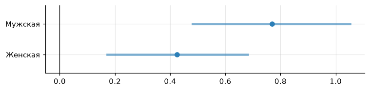
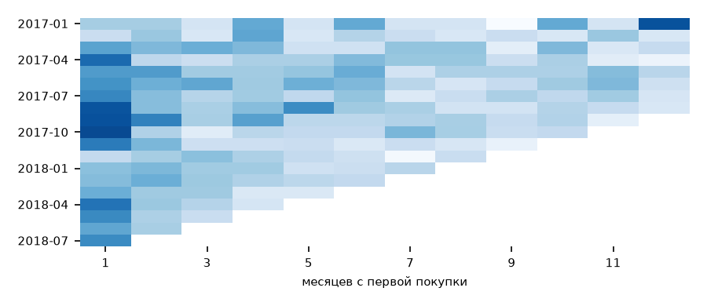

::: {.lead}
Анализирую данные рекламных кампаний и пользователей: SQL, Python, A/B-тесты, Power BI.
С 2024 года в OKKAM собираю данные Яндекс Метрики, Google Analytics и рекламных кабинетов
в отчёты для клиентов и перераспределяю бюджеты между каналами по результатам кампаний.
:::

[Резюме](cv.qmd){.btn .btn-primary .btn-sm}
[GitHub](https://github.com/wickedstacy085){.btn .btn-outline-secondary .btn-sm}
[anastasiasmirnova085@gmail.com](mailto:anastasiasmirnova085@gmail.com){.btn .btn-outline-secondary .btn-sm}

::: {.kpis}
::: {.kpi}
**50+ млн ₽**
[бюджеты кампаний, с которыми работаю]{}
:::
::: {.kpi}
**ROMI > 100%**
[в нескольких кампаниях после перераспределения бюджета]{}
:::
::: {.kpi}
**НИУ ВШЭ**
[экономист, 2025; эконометрика и анализ данных]{}
:::
:::

## Проекты

::: {.cards}
::: {.card-project}
{fig-alt="Прирост выручки на клиента от мужской и женской версий письма с доверительными интервалами"}

::: {.body}
### [A/B-тест email-рассылки](https://wickedstacy085.github.io/ab-test-email/)

Какое письмо отправлять и кому: 64 000 клиентов, три группы.

[Мужская версия всем: +$0,77 выручки на клиента (+118%), ≈ $77 тыс. на 100 тыс. писем.]{.result}

::: {.links}
[Страница проекта](https://wickedstacy085.github.io/ab-test-email/) [Код](https://github.com/wickedstacy085/ab-test-email)
:::

[Python · SRM · мощность и MDE · бутстрап · CUPED · поправка Холма · сегменты]{.tags}
:::
:::

::: {.card-project}
{fig-alt="Тепловая карта retention когорт: почти все значения меньше 1%"}

::: {.body}
### [Когорты и юнит-экономика на SQL](https://wickedstacy085.github.io/ecommerce-sql/)

96 тыс. заказов маркетплейса Olist: растёт ли бизнес за счёт постоянных клиентов и где теряет деньги.

[Повторно покупают 3% клиентов — CAC должен окупаться первым заказом; 7% опоздавших заказов дают треть негативных отзывов.]{.result}

::: {.links}
[Отчёт](https://wickedstacy085.github.io/ecommerce-sql/) [Дашборд](https://wickedstacy085.github.io/ecommerce-sql/dashboard.html) [Код](https://github.com/wickedstacy085/ecommerce-sql)
:::

[SQL (DuckDB) · оконные функции · когорты · LTV · RFM · Plotly-дашборд · витрина Power BI]{.tags}
:::
:::
:::

## Инструменты

- **SQL:** джойны, CTE, оконные функции, когорты и retention, DuckDB
- **Python:** pandas, numpy, scipy, statsmodels, matplotlib, pytest
- **Эксперименты:** дизайн теста, мощность и MDE, SRM, бутстрап, CUPED, множественные сравнения
- **BI и отчёты:** Power BI, Excel (Power Query, XLOOKUP, сводные таблицы), Quarto, PowerPoint, think-cell
- **Маркетинговые данные:** Яндекс Метрика, Google Analytics, рекламные кабинеты, programmatic (DSP, SSP, DMP)

Другое направление — эконометрика, макро и финансы: [wickedstacy085.github.io](https://wickedstacy085.github.io/).
